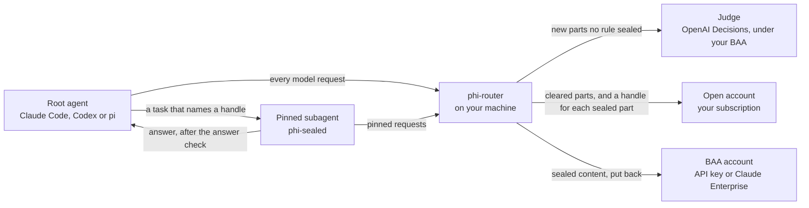

# phi-router

A [HIPAA-aligned](#what-hipaa-aligned-means-here) router that runs Claude Code, Codex or pi on your flat-rate subscription, while only your BAA account reads PHI.

[](https://www.npmjs.com/package/phi-router)
[](https://github.com/drsh4dow/phi-router/actions/workflows/check.yml)
[](LICENSE)

![pi on phi/auto reads a synthetic patients.csv. The open account receives only [sealed h1], and /phi counts 1 sealed message.](docs/demo.gif)

A real capture of pi with phi-router, run against the mock accounts of the [verify-router](.agents/skills/verify-router/SKILL.md) skill, at no cost. The agent reads `patients.csv`, a synthetic record with the voided SSN `078-05-1120`. The mock open account replies with the text it received, so its reply shows that it got `[sealed h1]` and none of the record. `/phi` then counts 1 sealed message. `target-under-test` is the mock's model name.

## What you get

- **Your subscription does the everyday work.** In a scripted claims session, the BAA account received 1 of 9 model requests, and 37,014 of the 481,249 bytes the two accounts received. Your subscription ran the rest. See [What it saves](#what-it-saves).
- **PHI stays on your BAA account.** On a synthetic corpus, 0 of 282 cases with PHI leaked to an open account, and 41 of 352 clean cases were over-sealed. See [Proof](#proof).
- **It fails closed.** When the router is down or cannot check a message, the message is not sent.

## How it works



Your agent works on your subscription as usual. A part of a request that holds PHI reaches the subscription as a short handle, such as `[sealed h3]`. When the work needs that part read, the agent hands it to a subagent that runs on your BAA account.

### What it does

phi-router is a local router. Your harness sends every model request to it, and it reads what is new in each one.

- Your agent runs on your subscription, the open account outside any BAA. A message that holds PHI, such as a tool result with patient names, reaches the subscription as a short handle like `[sealed h3]`, and phi-router keeps the message on your machine.
- Rules catch the unambiguous identifiers, such as an SSN. A judge model under your BAA decides the rest.
- When the work needs a sealed message read, your agent hands a scoped task that names its handle to the pinned subagent `phi-sealed`, which runs on your BAA account. phi-router checks the subagent's answer before your agent reads it. An answer that still holds PHI goes back to the subagent with the reason, up to five times, and then your agent gets a handle instead. Patient identifiers you need in the result go to a private file on your machine, and the answer gives its path.
- Claude Code and [pi-harness](https://github.com/drsh4dow/pi-harness) run this flow. Codex and stock pi need a subagent system you set up, as [SETUP.md](SETUP.md) says. A session on the model `phi/sealed` runs wholly on the BAA account.
- `/phi` shows the session's accounts, how many messages were sealed and cleared, and the pinned subagent's runs and rewrites. In Codex, type it without the slash. In Claude Code the status line shows the same counts while a phi model is picked.
- You can list several subscriptions. A rate limit on one moves the request to the next, and when all of them fail it runs on the BAA account, still with handles in place of PHI. A request never moves from the BAA account to a subscription. At the end of a turn that ran on the BAA account this way, phi-router says why and how to add another subscription, and `/phi` shows when a rate-limited subscription is back.
- The router runs only while a session of your harness runs, and installs no system service. When it is down, requests fail instead of leaving unchecked.

## Get started

You need a coding agent (Claude Code, Codex or pi) logged in to your subscription, and Node or Bun. On an API key alone there is nothing to protect, and setup says so. You also need an OpenAI API key under your organization's BAA for the PHI check, and for Claude Code or pi an Anthropic API key or a Claude Enterprise login under the same BAA. Setup finds what your machine already has and asks only for the rest.

Paste this into your coding agent:

```text
Install phi-router for your harness by following its SETUP.md in https://github.com/drsh4dow/phi-router/blob/main/SETUP.md
```

Claude Code sets it up in the same window, and you paste any key it needs in the plugin's masked field. pi sets it up in the same window, and you type any key it needs in a masked field. Codex sets it up in the chat, and you type any key it needs in a terminal. Or run it yourself, with `codex` or `pi` in place of `claude`:

```sh
npx phi-router setup claude
```

By hand in pi, run `pi install npm:phi-router`, then type `/reload` and `/phi setup`.

New releases arrive by themselves in Claude Code and Codex, from phi-router's release channel, and load in the next session. The router your open windows share keeps the version it started with until you close them all, and a new window says so when a newer one waits. pi tells you when one is out, and `pi update --extensions` takes it. To update now in any of them, run `npx phi-router@latest setup claude`, with `codex` or `pi` in place of `claude`. It keeps your accounts and asks nothing it already knows.

phi-router checks each message for patient data before it is sent. The check runs on OpenAI Decisions under your BAA. Messages it flags, or cannot clear, reach your subscription only as handles, and only your BAA account reads them. Everything else goes to your subscription as before. Setup asks which account your BAA covers and, on a first run, whether to add another subscription. To add one later, run `npx phi-router accounts add`. For a Claude Enterprise login or a key in a password manager, see [Accounts](docs/accounts.md).

## Proof

`bun run eval:recorded` replays a synthetic corpus through the policy, lane choice and the border, with the judge's recorded answers, so it calls no API. Every case and identifier in it is generated. None is a real patient.

| `bun run eval:recorded`                                               | Result    |
| --------------------------------------------------------------------- | --------- |
| In-policy PHI cases whose complete identifier reached an open account | 0 of 282  |
| Clean cases over-sealed, where a request sealed a part                | 41 of 352 |
| Clean requests that sealed a part                                     | 48 of 810 |
| Judge calls                                                           | 3,031     |
| Judge cost, from the recorded token counts                            | $0.6132   |

The corpus covers the 12 identifier kinds the policy names, such as names, SSNs, MRNs, member numbers and face photos. They sit in 12 carriers, such as FHIR JSON, HL7v2, X12 837, SQL dumps, log lines and screenshots. Some are encoded as base64 or gzip, split, minified, misspelled or written in another language.

An over-sealed part reaches your subscription as a handle. Your agent works without it, or hands it to the pinned subagent on the BAA account, which bills per token. 19 of the 41 over-sealed cases hold a fragment of an identifier, which the policy does not count as PHI.

Zero leaks in a sample does not prove a zero leak rate. The eval prints a one-sided 95% upper bound for each kind and carrier. For the 74 plain-text cases it is 0.0397. `bun run check` runs the same replay on every pull request and fails on any leak. The wire runs in [verify-router](.agents/skills/verify-router/SKILL.md) drive the real Claude Code, Codex and pi binaries through the router against mock accounts, and fail when an open account receives a complete synthetic identifier.

## What it saves

Without phi-router, an agent that may read PHI runs every request on the BAA account, billed per token. With phi-router, the root agent runs on your subscription. Only the pinned subagent, the judge, and any request no subscription took are billed per token.

`bun run cost .` measures this and spends nothing. It drives the real Claude Code binary through the router against mock accounts, in one scripted session. The agent reads three files and runs a query whose rows hold member names and member numbers. It hands the rows to the pinned subagent, fixes the query, reruns it and reports. Three runs gave the same counts.

| `bun run cost .`                | Requests | Bytes received |
| ------------------------------- | -------- | -------------- |
| Open account, your subscription | 8        | 444,235        |
| BAA account                     | 1        | 37,014         |
| Judge                           | 22 calls | 145,510        |

The estimate below prices that session at list prices, read on 2026-11-26. Claude Opus 5.5, which `phi/auto` runs on Anthropic, costs $4 per million input tokens on [Anthropic's pricing page](https://platform.claude.com/docs/en/about-claude/pricing). The judge costs $0.10 per million input tokens on [OpenAI's Decisions guide](https://developers.openai.com/api/docs/guides/decisions#pricing-and-availability). Bytes become tokens at 4 bytes per token, since Anthropic's page puts a 10 kB web page at about 2,500 tokens.

| Estimate, input tokens only | Every request on the BAA account | With phi-router                               |
| --------------------------- | -------------------------------- | --------------------------------------------- |
| Tokens billed               | 111,059 on the BAA account       | 9,254 on the BAA account, 36,378 on the judge |
| Cost per session            | $0.44                            | $0.04                                         |
| Cost per 1,000 sessions     | $444                             | $41                                           |

The left column counts only the 8 requests your subscription received with phi-router. Without phi-router those requests would carry the query rows in place of handles, so they would be larger. The estimate leaves out output tokens, prompt caching, which lowers both columns, and your subscription's flat fee. The more of a session needs PHI read, the more of it runs on the BAA account.

## How it compares

|                                  | Everything on a BAA API key              | A Claude Enterprise seat with HIPAA enabled | A redaction tool such as [Microsoft Presidio](https://github.com/microsoft/presidio) | phi-router                                          |
| -------------------------------- | ---------------------------------------- | ------------------------------------------- | ------------------------------------------------------------------------------------ | --------------------------------------------------- |
| Where everyday requests run      | The BAA account, billed per token        | The Enterprise account                      | The account the agent already uses                                                   | Your subscription                                   |
| Where a message with PHI goes    | The BAA account                          | The Enterprise account                      | The same account, with each identifier the tool found replaced                       | The BAA account. Your subscription gets a handle    |
| Can the agent work on the record | Yes                                      | Yes                                         | Only on the redacted text                                                            | Yes, through the pinned subagent on the BAA account |
| When the check cannot run        | No check runs                            | No check runs                               | Up to the code you write                                                             | The message is not sent                             |
| Harnesses and models             | Any harness that takes that vendor's key | Anthropic's models                          | Any, through code you write                                                          | Claude Code, Codex and pi, on Anthropic or OpenAI   |

Presidio's README says there is no guarantee that it finds all sensitive information. The same holds for phi-router's rules and judge, which is why [Proof](#proof) measures them. phi-router can also use a [Claude Enterprise login](docs/accounts.md#use-a-claude-enterprise-login) as its BAA account.

## What HIPAA-aligned means here

HIPAA-aligned means phi-router keeps PHI on the accounts your BAA covers. It is not a certification, and it does not make your use of AI meet HIPAA for you.

phi-router does this:

- PHI that the rules or the judge find reaches only the accounts you list as BAA accounts. Every other account receives a sealed handle, such as `[sealed h3]`, in its place. A part not yet judged reaches those accounts as a stub too.
- The router fails closed. When it is down, requests fail. When it cannot check a part, the part stays sealed.
- Rules on your machine and a judge that runs under your BAA decide what is PHI. A part they cannot clear stays sealed.

You keep this:

- The BAA itself, with each vendor whose account reads PHI, and confirming that it covers each account as phi-router reaches it.
- The policy. phi-router's definition of PHI is a routing rule, described in the [FAQ](#what-counts-as-phi-here). Check it against your own.
- Your compliance program: risk analysis, access control, training, and the machine phi-router runs on, which keeps sealed content on its disk.

## FAQ

### What counts as PHI here?

Content that holds a complete direct identifier of a real patient or member. The policy names 12 kinds: a name, an SSN, a full date of birth, a home street address, a personal phone number, a personal email, an insurance member number, a Medicare or Medicaid number, a medical record number, a driver license number, a passport number, and a face photo. Internal ids, health facts tied only to an internal id, staff and vendor contacts, fragments and counts are not PHI for routing. This is a routing rule, not a legal definition.

### What happens when the router is down?

The request fails, since your harness sends model requests only to the router. Before each prompt and each compaction, your harness asks the router to prove it is your router, and blocks the prompt when it cannot. Two cases are not checked: a request your harness sends before the first prompt, and the rest of a turn after the router crashes. In both, another user on the same machine who takes the router's port can read the request ([ADR 0002](docs/adr/0002-a-prompt-waits-until-the-router-proves-it-is-yours.md)). The router runs only while a session of your harness runs.

### What does the judge see?

Each new part that no rule sealed, one at a time, without the conversation around it ([ADR 0013](docs/adr/0013-the-judge-reads-a-piece-without-context.md)). It runs on OpenAI's Decisions API with your key under your BAA. When the judge fails to answer, the part is sealed.

### Where does sealed content live?

On your machine. The router keeps each sealed part in the session's sealed store, a 0600 file in your XDG state folder, so the pinned subagent can read it after a compaction or a restart. Nothing deletes it ([ADR 0016](docs/adr/0016-the-root-agent-stays-on-the-open-account.md)).

### Does it work with Codex and pi?

Yes. Setup runs in Claude Code, Codex and pi. Claude Code and pi-harness check the pinned subagent's answer before your agent reads it. Codex runs the pinned subagent without that check. Stock pi has no subagents, so for PHI work you switch to `phi/sealed` or install pi-harness. [SETUP.md](SETUP.md#work-that-needs-phi-in-codex-and-stock-pi) has the details.

## Security and contributing

Report a vulnerability or a suspected leak privately, as [SECURITY.md](SECURITY.md) says. Never put real PHI in an issue. [CONTRIBUTING.md](CONTRIBUTING.md) says how to run the checks.

## Disclaimer

This software comes with no warranty. The author takes no responsibility for how you use it, including with policies other than the one it ships.
